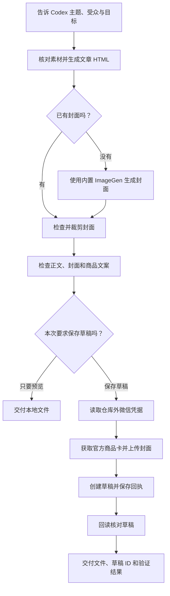

# 微信公众号图文助手 · Codex Skill

在 Codex 里说出主题，就能完成 **写稿 → 内置 ImageGen 生成封面 → 挂商品卡 → 保存公众号草稿 → 回读确认**。

这是为“天启云AI”整理的可复用技能。可以只制作本地文章和封面，也可以在你明确要求时上传到微信公众号草稿箱。正式发布仍在公众号后台完成。


## 它能做什么

| 工作 | 做法 |
| --- | --- |
| 文章 | 根据主题和真实材料写稿，生成微信适用的 HTML 排版 |
| 封面 | 使用 Codex 内置 ImageGen，检查文字后裁成 900×383 |
| 商品 | 根据商品 ID 获取微信官方商品卡，插入正文 |
| 草稿 | 上传封面，保存草稿，并回读核对标题、作者、摘要、封面及商品卡 |
| 本地预览 | `--dry-run` 只保存本地预览，无需微信密钥，不联网 |

默认作者为 **天启云AI**，默认商品为 **GPT实战营**，商品 ID **`10000828419925`**，默认使用小卡。默认值统一保存在 [`config/defaults.json`](config/defaults.json)，可修改，也可在每次请求中覆盖。

这里的“挂商品”是插入已有商品的购买卡片；创建商品、调整价格库存和商品上下架仍在微信小店后台处理。

## 使用流程



## 安装到 Codex

在终端执行：

```bash
git clone https://github.com/tianqiyun3090-bot/wechat-oa-publish.git
cd wechat-oa-publish
python3 scripts/install_skill.py
```

默认安装到 `$CODEX_HOME/skills/wechat-oa-publish`；未设置 `CODEX_HOME` 时为 `~/.codex/skills/wechat-oa-publish`。下一条 Codex 消息即可使用 `$wechat-oa-publish`。更新已有版本时：

```bash
git pull --ff-only
python3 scripts/install_skill.py --force
```

`--force` 会先把旧版本备份到 skills 目录旁的 `skill-backups`，再安装新版本。仓库的 `.git` 和运行产物不会复制到技能目录。

## 直接对 Codex 说什么

**完整制作并保存草稿：**

```text
$wechat-oa-publish
帮我做一篇关于“Codex的实用方向”的公众号文章，约1000字。
使用内置 ImageGen 生成笔记本风格封面，挂默认商品，最后保存到公众号草稿箱。
```

**只制作预览，不上传：**

```text
$wechat-oa-publish
写一篇面向普通上班族的Codex入门文章，生成封面。
只给我本地预览，不上传，不插商品卡。
```

**换商品或作者：**

```text
$wechat-oa-publish
把我提供的稿子排版，作者改为“我的品牌”。
使用已有封面，挂商品ID 你的商品ID，按我提供的商品资料写引导语，保存到草稿箱。
```

**复查已有草稿：**

```text
$wechat-oa-publish
用上次的 publish-receipt.json 重新检查草稿，不创建新的草稿。
```

也可以直接说“帮我做公众号图文并保存草稿”，由 Codex 选择这个技能；显式写 `$wechat-oa-publish` 更清楚。[Codex 官方技能调用说明](https://developers.openai.com/blog/eval-skills)

## 首次配置微信公众号

只制作本地文章和封面时，无需配置微信账号。上传草稿时需要同一公众号的 AppID、AppSecret，以及对应的微信素材、草稿和商品卡权限。

将账号文件放在源码仓库之外：

```bash
mkdir -p ~/.config/wechat-oa-publish
cp config/wechat.env.example ~/.config/wechat-oa-publish/wechat.env
chmod 600 ~/.config/wechat-oa-publish/wechat.env
```

在编辑器中打开这个文件，把占位内容替换为自己的信息：

```ini
WECHAT_APPID=your_wechat_appid
WECHAT_SECRET=your_wechat_appsecret
```

不要将真实密钥放进 `config/defaults.json`、`SKILL.md` 或 README。仓库只包含配置示例，没有真实账号凭据。公众号后台若要求 IP 白名单，按微信错误中返回的实际出口 IP 配置。

脚本也支持当前进程的 `WECHAT_APPID`、`WECHAT_SECRET`。账号优先级为 **命令行参数 → 环境变量 → 仓库外账号文件**。为了兼容原版，新的默认配置文件不存在时，会尝试 `~/.workbuddy/wechat.env`。更多细节见 [`references/account-setup.md`](references/account-setup.md)。

## 如何保存自己的默认商品

修改 [`config/defaults.json`](config/defaults.json)：

```json
{
  "author": "天启云AI",
  "product_id": "10000828419925",
  "product_name": "GPT实战营",
  "card_type": 1
}
```

商品 ID 使用字符串。`product_name` 帮助 Codex 写文案；脚本实际插入的是微信返回的官方商品卡，价格和详情以商品页面为准。

单次覆盖可用 `--product-id`、`--author`、`--card-type`，或在提示词中说明。不挂商品使用 `--no-product-card`；Codex 会同时移除推广文案。卡片类型为：`0` 大卡、`1` 小卡、`2` 文字链、`3` 条卡。

## 脚本用法

通常由 Codex 执行这些命令。也可在仓库目录手动运行：

```bash
# 纯本地预览，无需微信凭据。HTML 需保留 <!--PRODUCT_CARD-->。
python3 scripts/publish_draft.py \
  --content outputs/demo/content.html \
  --title "文章标题" --digest "文章摘要" \
  --cover outputs/demo/cover-900x383.png \
  --output-dir outputs/demo/wechat --dry-run

# 保存并验证草稿：去掉 --dry-run，使用默认作者和商品。
python3 scripts/publish_draft.py \
  --content outputs/demo/content.html \
  --title "文章标题" --digest "文章摘要" \
  --cover outputs/demo/cover-900x383.png \
  --output-dir outputs/demo/wechat

# 已创建但回读未完成：仅重新验证，不再次提交。
python3 scripts/publish_draft.py \
  --verify-receipt outputs/demo/wechat/publish-receipt.json
```

`--thumb-media-id` 可复用已有永久封面素材，替代 `--cover`。`--env-file` 可指定仓库之外的账号文件。完整参数见 `python3 scripts/publish_draft.py --help`。

每篇文章使用独立输出目录。提交成功后保存 `publish-receipt.json`、`article-submitted.html` 和回读的 `article-saved.html`。退出码 `0` 表示本地预览成功或草稿回读通过；`1` 表示失败或创建结果尚不确定，核对错误与回执；`2` 表示草稿已存在但回读未通过。

已有 `media_id` 或创建请求结果不确定时，脚本会阻止重复提交。先回读或在后台核对；只有明确需要另一份草稿时才用 `--force-new-draft`，它会备份旧回执。脚本不自动重试微信写入请求。

## 环境要求与范围

- Codex 中可用的内置 ImageGen：新封面通过它生成，无需额外 `OPENAI_API_KEY`。图片生成会使用相应额度。
- Python 3.9+：发布和安装脚本仅使用标准库，无需 `pip install`。
- macOS：封面裁剪使用系统自带 `sips`；其他平台可提供已经裁好的 900×383 封面，发布脚本仍可使用。
- 微信公众号：需要对应账号权限；商品卡还需对应带货能力。公众号正文中的图片素材上传、商品创建、正式发布和群发不在脚本功能内。
- 工具不可用时，技能会说明限制；不会静默改用第三方图片生成服务。

## 文件结构

```text
wechat-oa-publish/
├── SKILL.md                       # Codex 的执行说明
├── README.md                      # 安装、配置和使用方法
├── agents/openai.yaml             # 技能列表的展示信息
├── config/
│   ├── defaults.json              # 可公开的作者与商品默认值
│   └── wechat.env.example         # 仓库外账号文件示例
├── scripts/
│   ├── install_skill.py           # 安装及备份旧版本
│   ├── publish_draft.py           # 本地预览、保存草稿、回读
│   └── crop_cover.sh              # macOS 封面裁剪
├── references/
│   ├── writing-guide.md           # 可覆盖的默认写作风格
│   └── account-setup.md           # 账号配置和问题处理
├── assets/
│   ├── article-template.html      # HTML 起始模板
│   └── readme-cover.png           # 示例封面
└── tests/test_publish_draft.py    # 离线行为验证
```

## 本地验证

```bash
python3 -m unittest discover -s tests -v
bash -n scripts/crop_cover.sh
```

测试验证本地预览不联网、默认商品、中文请求编码、发布回读、失败回执与重复提交保护，使用模拟微信响应，不创建真实草稿。真实上传仍取决于你的微信账号权限和网络环境。
